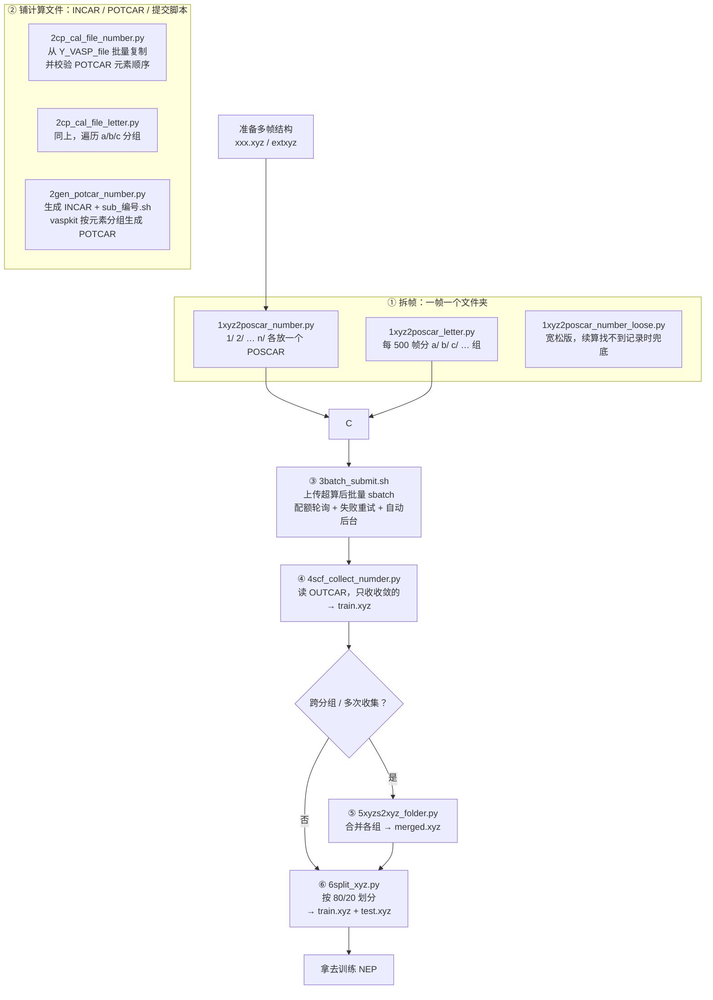

# batch_scf 批量单点能（SCF）计算流程

一条"把多帧结构拆成一个个 VASP 任务 → 上超算批量算 → 把能量收回来"的流水线，
最终产物是给 NEP 势训练用的 `train.xyz`（extxyz，含 `energy` 与 `virial`）。

---

## 一、流程图



一句话流程：**拆帧 → 铺文件 → 批量提交 → 收能量 → 合并 → 划分**。

---

## 二、各个脚本是干什么的（大白话）

### 第 1 步：把一个轨迹文件拆成一堆 POSCAR

| 脚本 | 通俗解释 |
| --- | --- |
| `1xyz2poscar_number.py` | **主力版。** 读入一个 xyz（多帧），每帧单独建一个数字文件夹 `1/ 2/ … n/`，里面放一个 `POSCAR`。所有帧的原子都按**同一套元素顺序**排好，保证后面 POTCAR 只要拼一次就能全部通用。 |
| `1xyz2poscar_letter.py` | **分组版。** 帧数太多（几千帧）时用得着：每 500 帧装进一个字母目录 `a/ b/ c/ …`，字母目录下再放以**全局帧号**命名的子文件夹（`a/1`、`a/2`、`b/501`…）。相当于给数字文件夹套了一层"批次盒子"，方便分卷拷贝、分卷提交。 |
| `1xyz2poscar_number_loose.py` | **应急版。** 和 number 版几乎一样，唯一区别：续算（`-con`）时如果找不到元素顺序记录文件 `.elements_order.txt`，它不会直接罢工，而是从已有最大文件夹的 `POSCAR` 里把元素顺序"猜"回来。用于处理旧版脚本留下的老目录，用后即弃。 |

number 版的两个模式：

- `-def`（默认）：从 `1/` 开始全新分发。若目录里已有带 POSCAR 的数字文件夹会直接拒绝，防止把算好的结果覆盖掉。
- `-con`：**续算**。先数一下现在最大是几号文件夹，新数据从 `最大号 + 1` 接着往下发。专门用于"补充数据再做一轮单点能"，并会顺带检查 `.elements_order.txt`、检查有没有新元素混进来（有就终止，否则元素顺序会漂移）。

> `.elements_order.txt` 是续算的命根子，别删。`-con` 时它决定了新旧 POSCAR 第 6 行必须一致。

### 第 2 步：把 INCAR / POTCAR / 提交脚本铺进每个任务文件夹

这一步有两条路，任选其一。

**路线 A —— 复制现成的（`2cp_cal_file_number.py` / `2cp_cal_file_letter.py`）**

- 从 `Y_VASP_file/` 里把 `INCAR`、`POTCAR`、`*.sh` 批量拷到每个任务文件夹。
- 拷之前会做一道**关键体检**：把 POTCAR 里的元素顺序（`VRHFIN` 出现的先后）和 POSCAR 第 6 行对比，不一致就直接停，避免"元素对错位"这种最恶心的事故。
- `INCAR` 和 `*.sh` 缺了会自动生成一份默认的（LF 换行、UTF-8 无 BOM，Linux 能直接用）；但 **POTCAR 不会自动生成，必须自己放**。
- 终端会提醒"你用的是默认 INCAR / 默认提交脚本"，防止忘了改成自己的参数。
- number 版扫顶层数字文件夹 `1/ 2/ …`；letter 版扫 `a/…/1` 这种两层结构。两者只差一个目录遍历方式。

**路线 B —— 现场生成（`2gen_potcar_number.py`）**

- 在**超算登录节点**上跑，要求 PATH 里有 `vaspkit`。
- 每个数字文件夹里直接写 `INCAR` 和 `sub_<编号>.sh`（`{name}` 会替换成文件夹号，Slurm 作业名也就跟着编号走，队列里一眼能看出是哪个任务），并清理目录里旧的 `sub*.sh`（一个目录只留一个提交脚本，否则批量提交可能提交错）。
- POTCAR 用它按元素顺序**分组**：同一种元素组合的所有文件夹只调用一次 `vaspkit -task 103` 生成，然后组内复制。组多的时候比一个个生成快得多。
- 生成前先把旧 POTCAR 全删掉，生成后再**全量校验**一遍；对不上顺序的 POTCAR 直接删（宁可缺文件，也不留错配的赝势被提交）。最后写一份 `potcar_gen.txt` 记录每个文件夹的元素顺序、来源（生成/复制）和校验结果。

### 第 3 步：批量提交（`3batch_submit.sh`）

放在任务父目录里直接 `./3batch_submit.sh`，它会**自动转后台**（等价 `nohup ... > submit.log`）并写锁文件防重复启动。

它干的事：

1. 扫所有数字文件夹（`[0-9]*`），**只挑还没有 `*.log` 的**（有日志说明提交过了），按名字大小排序。
2. 每次提交前检查 `INCAR`、`POSCAR`、`POTCAR`、`sub*.sh` 齐不齐，不齐就跳过并告警（`KPOINTS` 可选，因为 INCAR 里用的是 `KSPACING`）。
3. 用 `squeue` 数自己的任务数，控制在 `MAX_TOTAL_JOBS=18` 个以内，每轮最多补 `BATCH_SIZE=9` 个；队列满了就指数退避（20s → 40s → 60s 封顶）轮询，一有空位立刻补位。
4. `sbatch` 失败（配额拒绝等）**不算提交成功**：不推进、下一轮重试同一个目录；连续失败 3 次才跳过并记入清单。
5. 全部提交完 `touch .batch_submit.done`，之后再跑会被拒绝（要重提交先 `rm .batch_submit.done`）。有目录被跳过时不写完成标记，修好后再跑一次能自动补齐。

日志只有一份 `submit.log`，每轮格式固定：`[时间戳]` → `【配额检查】`/`【提交作业】` → 明细行（处理目录、JobID）。

### 第 4 步：收集能量（`4scf_collect_numder.py`）

- 扫所有数字文件夹，读 `OUTCAR`。
- 用 `aborting loop because EDIFF is reached` 是否**恰好出现 1 次**来判断收敛 —— 0 次是算崩了/没收敛，多次说明这个 OUTCAR 不干净，都跳过。
- 收敛的把最后一步结构读进来，`free_energy` 存成 `energy`，`stress × 体积`（取负）换算成 `virial` 矩阵写进 `info`。
- 攒够 50 个才落盘一次，省内存；输出 `train.xyz`（extxyz 内容）。
- 最后终端会打一张"没收到的是哪些、为什么"的表格，同时写 `collect_info.txt`。

### 第 5 步：合并（`5xyzs2xyz_folder.py`，可选）

字母分组方案下，收集是在 `a/ b/ c/` 各组里分别做的，各有一份 `train.xyz`。这个脚本按文件夹顺序把它们拼起来：

- 不传参数：自动扫脚本所在目录的所有子文件夹；传参数：按你给的顺序合并。
- **xyz 和 extxyz 分开合**，不混：`merged.xyz` / `merged.extxyz`。
- 每个文件末尾缺换行会补一个，防止两帧粘在一起；帧数为 0 的"假 xyz"（比如误放的 txt）会被跳过并警告。
- 合并记录追加到 `merged.txt`（不覆盖历史）。

### 第 6 步：划分（`6split_xyz.py`，可选）

按 80% / 20% 随机切成训练集和测试集，`train.xyz` + `test.xyz`，默认种子 42（同样种子结果可复现）。

用法：`python 6split_xyz.py merged.xyz 输出目录 42`（输出目录不给就落到脚本里写死的默认路径，记得改）。

### 附：`3.txt`

不是脚本，是一条备忘命令：`cp scf_collect.py batch_submit.sh [a-z]/` —— 字母分组方案下，把收集/提交脚本拷进每个分组目录，好在组内分别提交和收集。

---

## 三、最简跑法（数字文件夹方案）

```bash
# 0. 准备：把 Y_VASP_file/ 里的 INCAR、POTCAR、sub2.sh 换成自己的

# 1. 拆帧（Windows 本地）
python 1xyz2poscar_number.py data.xyz

# 2. 铺文件（二选一）
python 2cp_cal_file_number.py          # 用现成的 INCAR/POTCAR/脚本
python 2gen_potcar_number.py           # 或用 vaspkit 现场生成 POTCAR

# 3. 上传整个目录到超算，登录节点上
./3batch_submit.sh
tail -f submit.log

# 4. 全部算完后收集
python 4scf_collect_numder.py          # → train.xyz + collect_info.txt

# 5. 划分（可选）
python 6split_xyz.py train.xyz ./NEP 42
```

补充数据再来一轮：`python 1xyz2poscar_number.py -con new.xyz` → 重新跑第 2、3、4 步即可（旧的 `1/ … n/` 不受影响）。

---

## 四、几个容易踩的坑

1. **元素顺序必须全流程一致**：拆帧时按全局统一顺序排，POTCAR 必须按 POSCAR 第 6 行拼，否则能量全错。第 2 步的校验就是为了拦住它。
2. **别删 `.elements_order.txt`**：删了 `-con` 会拒绝运行（宽松版除外），因为没法保证新旧 POSCAR 第 6 行对齐。
3. **别删 `.batch_submit.done` 之外乱跑 `3batch_submit.sh`**：它靠"有没有 `*.log`"判断是否提交过，日志被删会导致重复提交。
4. **`2gen_potcar_number.py` 会覆盖 INCAR 和提交脚本**：模板在配置区里，改模板而不是改生成后的文件。
5. **默认模板只是能跑**：`INCAR` 的 `ENCUT=500`、`IVDW=12`、`KSPACING=0.30` 和 `sub2.sh` 的分区/核数都是示例值，正式算之前一定换成自己体系的。
6. **`6split_xyz.py` 的默认输出目录是写死的本机路径**，换个环境记得传第二个参数。
